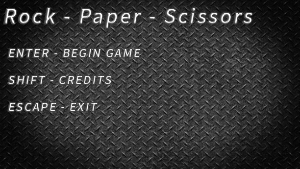
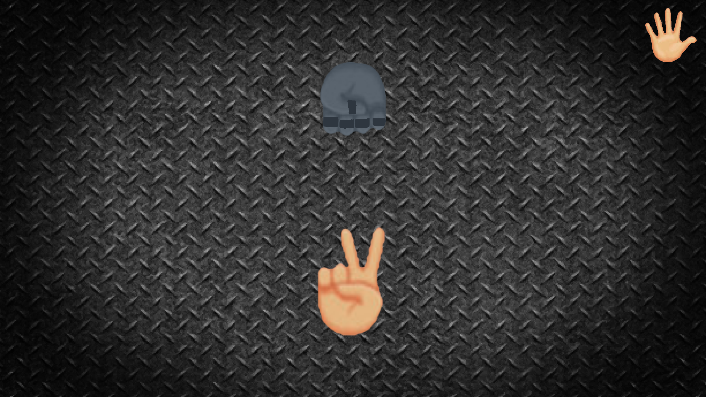

<hr>

# <h1 align="center">⚠️ Warning! This project is unlicensed for the time being. Do not redistribute or reuse the code/assets.</h1>

<hr>

# ✌ Rock-Paper-Scissors
<p align="center"></p>
  

<p align="center">A game where you risk your life playing rock paper scissors against a killer machine</p>

# ⭐ Features
<p align="center"></p>

- Rich horror atmosphere inspired by 2010s style
- Built with <b>SDL2</b> for graphics, audio, and input handling
- Functional AI with decision-making logic for countering player's moves
- Texture management with <b>SDL_Image</b>
- Sound system with <b>SDL_Mixer</b>
- Video decoding with <b>FFmpeg</b> onto frames readable by <b>SDL</b>

# 📝 Installing
1. Make sure that you have Visual Studio 2022 with C++ Installed
2. Clone this project in bash<br><br>
   ```bash
   git clone https://github.com/KeneKbee/Rock-Paper-Scissors.git
    ```

# 💻 Compiling and running
<p align="center"></p>
<p align="center">To compile and run the project open the <code>Game.sln</code> file with Visual Studio in "Game 1.5" folder and press <code>F5</code></code></p>

# ⚙ Configuring
### In file `options.ini` in "Game 1.5" folder are 3 configurable options:
- fullscreen - rendering the game window in current monitor's resolution (true or false)
- width - width of the game window (integer value)
- height - height of the game window (integer value)

# 🎮 How to play
- Begin the game by pressing Enter in the menu
- Choose your play (rock, paper or scissors) by pressing Z, X or C key on your keyboard
- Wait for the opponent's play
- Watch the result
- Try not to die

# 📦 Dependencies
- SDL2
- SDL_Image
- SDL_Mixer
- FFmpeg

# 🎵 Music
- Main Menu: ***"Heavy Containment"***</a> from <a href="https://scpcb.fandom.com/wiki/Music">**SCP:CB**</a> by *Kevin MacLeod & FireFox*
- Game Ambience: ***"Menu"***</a> from <a href="https://scpcb.fandom.com/wiki/Music">**SCP:CB**</a> by *Tim Morrison*
- Credits: ***"Impact Prelude"*** (edited) from <a href="https://incompetech.com">**incompetech.com**</a> by *Kevin MacLeod*, licensed under <a href="https://creativecommons.org/licenses/by/4.0/">CC BY 4.0</a>

<hr>

<h1 align="center">Created by <a href="https://github.com/KeneKbee">KeneKbee</a></h1>
